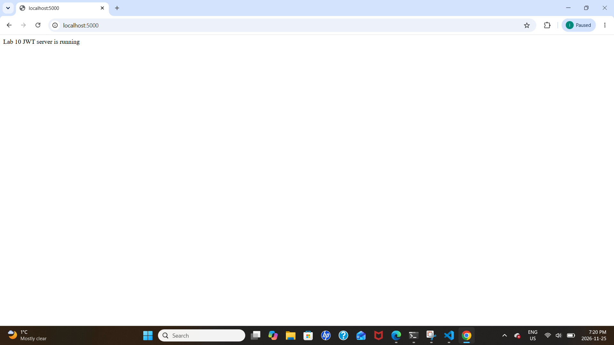
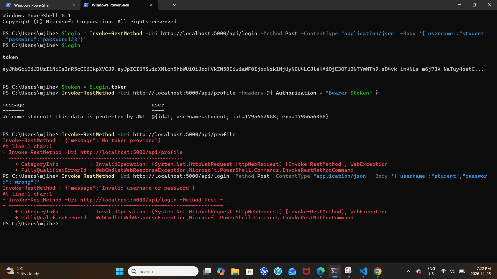
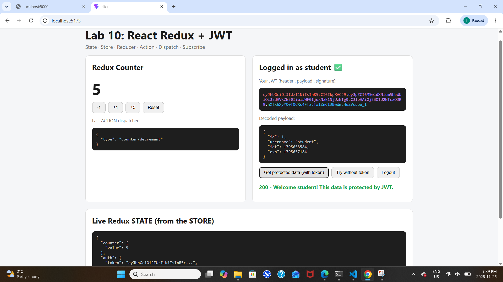
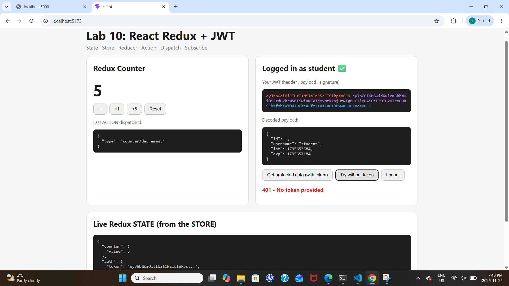
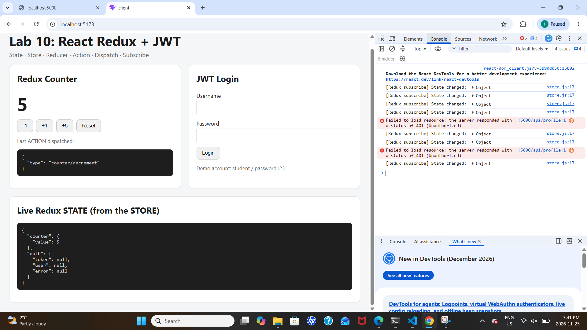

# Lab 10 – React Redux + JWT (JSON Web Token)

**Author:** MARTINS MADUABUCHI
**Course:** COMP3123– Self Directed Research and Innovation Exercise

A small full-stack app that demonstrates:
- **Redux** concepts: State, Store, Reducer, Action, Dispatch, Subscribe
- **JWT** authentication: login, signed token, protected API route

---

## 1. What is Redux?

Redux is a library that keeps all of an app's data in **one central place** (the store). Components read data from the store and send **actions** to change it, so data always flows in one direction and is easy to follow.

| # | Concept | Meaning | Where in this app |
|---|---------|---------|-------------------|
| 0 | **State** | The data the app holds right now | `initialState` in `counterSlice.js` and `authSlice.js` |
| 1 | **Store** | One object that holds the whole state | `configureStore()` in `store.js` |
| 2 | **Reducer** | Pure function: `(state, action) → new state` | `reducers: { increment, loginSuccess, logout, ... }` |
| 3 | **Action** | Plain object describing what happened | `{ type: "counter/increment" }`, `{ type: "auth/loginSuccess", payload }` |
| 4 | **Dispatch** | Sends an action to the store | `dispatch(increment())` in `Counter.jsx`, `dispatch(loginSuccess(data))` in `Login.jsx` |
| 5 | **Subscribe** | Runs a function every time the state changes | `store.subscribe()` in `store.js` logs the state and saves the JWT to localStorage |

**Redux flow:**
```
UI button → dispatch(action) → reducer → new state in store → subscribers + UI update
```

## 2. What is JWT?

A **JSON Web Token** is a signed string that proves who a user is. It has 3 parts separated by dots:

```
header.payload.signature
```
- **Header**: the algorithm (HS256) and type (JWT)
- **Payload**: data about the user (`id`, `username`, `iat` = issued at, `exp` = expires)
- **Signature**: made with a secret key; if anyone changes the token, verification fails

**JWT flow in this app:**
1. The user logs in, and the server checks the password and creates a token with `jwt.sign()` (valid for 1 hour)
2. The React app dispatches `loginSuccess`, which puts the token in Redux state
3. The app calls the protected route with the header `Authorization: Bearer <token>`
4. The server checks the token with `jwt.verify()`
   - valid token → **200** + protected data
   - no token → **401 No token provided**
   - bad or expired token → **403 Invalid or expired token**

## 3. Technologies
- **Frontend:** React (Vite), Redux Toolkit, React Redux
- **Backend:** Node.js, Express, jsonwebtoken, cors

## 4. Project Structure
```
lab10-redux-jwt/
├── server/
│   └── index.js              # Express server: /api/login and /api/profile (JWT)
├── client/
│   └── src/
│       ├── store/
│       │   ├── store.js        # STORE + SUBSCRIBE
│       │   ├── counterSlice.js # STATE, REDUCER, ACTIONS (counter)
│       │   └── authSlice.js    # STATE, REDUCER, ACTIONS (JWT/auth)
│       ├── components/
│       │   ├── Counter.jsx     # DISPATCH counter actions
│       │   ├── Login.jsx       # Login → get JWT → DISPATCH loginSuccess
│       │   └── Profile.jsx     # Shows/decodes JWT, calls protected route
│       ├── App.jsx             # Shows live Redux state
│       └── main.jsx            # <Provider store={store}>
├── screenshots/
└── README.md
```

## 5. API Endpoints
| Method | Route | Protected | Description |
|--------|-------|-----------|-------------|
| GET | `/` | No | Server health check |
| POST | `/api/login` | No | Body `{ username, password }` → returns `{ token, user }` |
| GET | `/api/profile` | **Yes (JWT)** | Needs header `Authorization: Bearer <token>` |

## 6. How to Run

**Requirements:** Node.js 18 or newer

**Terminal 1, the server:**
```bash
cd server
npm install
node index.js
```
→ runs on http://localhost:5000

**Terminal 2, the client:**
```bash
cd client
npm install
npm run dev
```
→ open http://localhost:5173

**Demo account:** `student` / `password123`

## 7. How to Test
1. Click **+1 / +5 / -1**: the counter changes, the action object is shown, and the console prints `[Redux subscribe] State changed:`
2. Log in with a wrong password: you see "Invalid username or password"
3. Log in with `student / password123`: the JWT and decoded payload are shown
4. **Get protected data (with token)** → `200 - Welcome student!`
5. **Try without token** → `401 - No token provided`
6. Refresh the page: you stay logged in (subscribe saved the token)
7. **Logout**: the token is removed from state and localStorage

## 8. Screenshots

### Server running


### Backend JWT tests (PowerShell)


### Logged in with JWT – protected data (200)


### Request without token blocked (401)


### Redux subscribe running in the console


## 9. Security Notes (what a real app would do differently)
- The secret key is hard-coded for this demo; a real app keeps it in an environment variable (`.env`)
- The demo user is hard-coded; a real app uses a database with hashed passwords (e.g. bcrypt)
- The JWT is stored in localStorage for simplicity; this can be exposed to XSS attacks, so production apps often use **httpOnly cookies**
- Always use **HTTPS** so tokens can't be intercepted

## 10. References
- Redux docs – https://redux.js.org
- Redux Toolkit – https://redux-toolkit.js.org
- React Redux – https://react-redux.js.org
- JWT introduction – https://jwt.io/introduction
- jsonwebtoken package – https://www.npmjs.com/package/jsonwebtoken